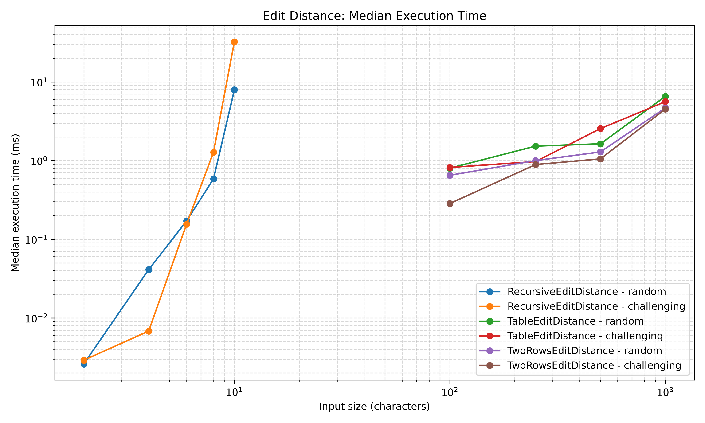
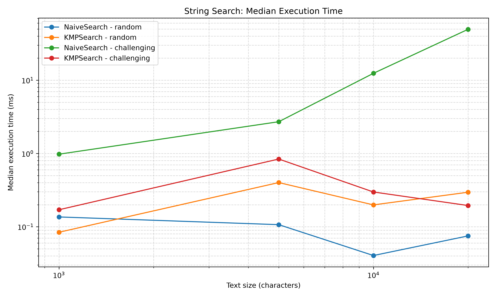
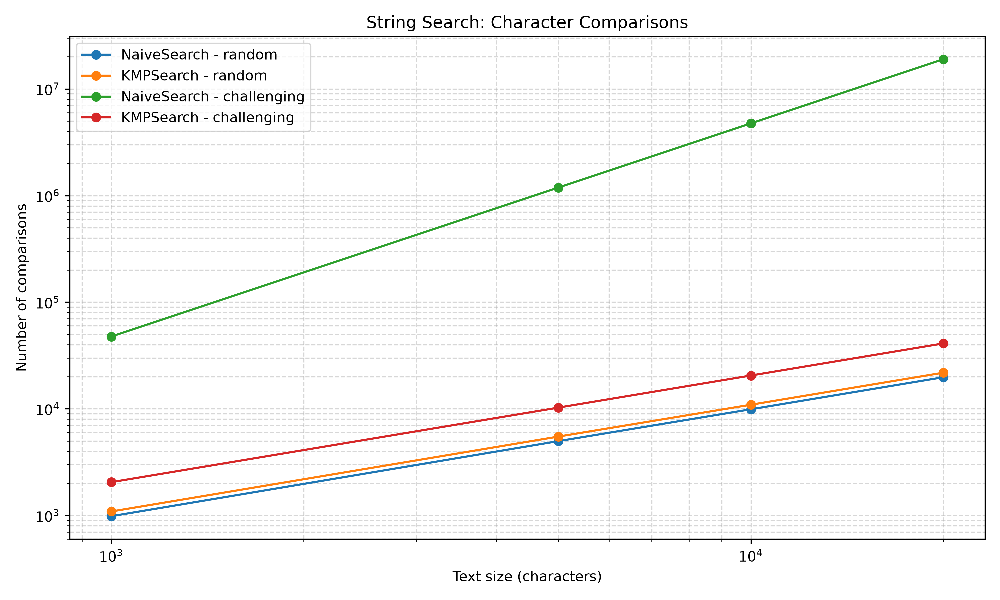

# Experiment Design Card

## 1. Research Questions

1. How does the recursive Edit Distance algorithm scale compared with the dynamic programming implementations?
2. How much memory and execution time can the two-row Edit Distance implementation save compared with the full-table implementation?
3. How do Naive Search and KMP differ in the number of character comparisons and execution time?
4. How do the algorithms behave on random inputs compared with challenging inputs?

## 2. Input Sizes

| Algorithm | Input sizes |
|---|---|
| Recursive Edit Distance | 2, 4, 6, 8, 10 |
| Table Edit Distance | 100, 250, 500, 1000 |
| Two-Rows Edit Distance | 100, 250, 500, 1000 |
| Naive Search | 1000, 5000, 10000, 20000 |
| KMP Search | 1000, 5000, 10000, 20000 |

The largest input is at least four times the smallest input in each size range.

## 3. Input Types

**Edit Distance**
- Random: strings generated from a fixed alphabet using a fixed random seed.
- Challenging: strings containing different repeated characters, such as `AAAA...` and `BBBB...`, to trigger mismatches.

**String Search**
- Random: random text and a randomly generated pattern.
- Challenging: text consisting of repeated `A` characters and a pattern consisting of repeated `A` characters ending in `B`. This creates many partial matches for Naive Search.

## 4. Metrics

- Median execution time in milliseconds, measured over 5 runs using `System.nanoTime()`.
- Number of recursive calls or DP cell calculations for Edit Distance.
- Number of character comparisons for String Search.
- Memory complexity based on the algorithm implementation.

## 5. Predictions

- Recursive Edit Distance will grow exponentially and become significantly slower as input length increases.
- Table Edit Distance will have O(n × m) time and O(n × m) memory complexity.
- Two-Rows Edit Distance will have O(n × m) time and O(m) auxiliary memory complexity.
- Naive Search will perform many comparisons on challenging inputs.
- KMP will generally perform fewer comparisons on challenging inputs because it reuses information from previous matches.

## 6. Planned Plots

1. Edit Distance execution time versus input size.
2. String Search execution time versus input size.
3. String Search comparison counts versus input size.

At least one plot will use a logarithmic axis if needed to make differences easier to compare.

## 7. Reproducibility

All random inputs will be generated using a fixed seed (`42`). Each measurement will be repeated five times, and the median execution time will be recorded. Each run will be stored as a separate row in `results/results.csv`.

# Experimental Results and Analysis

## 8. Plots and Takeaways

### Plot 1: Edit Distance Execution Time

**Takeaway:** Recursive Edit Distance grows rapidly as input size increases, especially on challenging inputs. The two dynamic programming implementations scale much more efficiently.

### Plot 2: String Search Execution Time

**Takeaway:** Naive Search becomes significantly slower on challenging inputs, while KMP maintains much better performance. On random inputs, Naive Search can be faster because it often finds mismatches quickly.

### Plot 3: String Search Character Comparisons

**Takeaway:** Naive Search performs dramatically more comparisons on challenging inputs, while KMP keeps the comparison count close to linear growth.

## 9. Prediction vs. Results

- **Recursive Edit Distance:** The prediction was confirmed. On challenging inputs of length 10, it performed 12,146,179 recursive calls and had a median execution time of 32.4405 ms.
- **Table vs. Two-Rows Edit Distance:** Both performed the same number of DP cell calculations. The two-row version uses less auxiliary memory, reducing space complexity from O(n × m) to O(m).
- **Naive vs. KMP:** The prediction was confirmed on challenging inputs. At text length 20,000, Naive Search took 49.4953 ms and performed 19,001,000 comparisons, while KMP took 0.1948 ms and performed 40,998 comparisons.
- **Random search inputs:** Naive Search sometimes performed better because random patterns often mismatch quickly. KMP also has the overhead of constructing its LPS table.

## 10. Complexity and Experiment Questions

### Edit Distance

| Algorithm | Time Complexity | Auxiliary Space |
|---|---|---|
| Recursive | Exponential | O(n + m) stack |
| Table | O(n × m) | O(n × m) |
| Two-Rows | O(n × m) | O(m) |

The two-row implementation reduces memory usage while preserving the same time complexity as the full-table implementation.

### String Search

| Algorithm | Time Complexity | Auxiliary Space |
|---|---|---|
| Naive Search | O(n × m) | O(1), excluding results |
| KMP | O(n + m) | O(m), excluding results |

KMP is especially effective when the pattern contains repeated prefixes and suffixes because it avoids rechecking previously matched characters.

## 11. Timing Methodology

Execution time was measured using Java's `System.nanoTime()`. Each experiment was repeated five times, and the median was used as the representative execution time. Random inputs were generated with a fixed seed of 42 to ensure reproducibility. Individual measurements and median results were stored in `results/results.csv`.
